# 🎬 Awesome Motion Graphics & Animation Engines

  

  
  
  
  
  
  

---

## 🚀 Overview & Ecosystem Scope

Welcome to the definitive, SEO-optimized directory of **Motion Graphics & Animation Engines**, covering cutting-edge **SaaS animation studios**, **cloud vector design suites**, **programmatic video-as-code frameworks**, **runtime state-machine players**, and **GPU-accelerated web animation libraries**.

Whether you are a motion designer crafting complex character rigs and micro-interactions, a frontend developer seeking high-frame-rate spring physics, or a video engineer automating mass video rendering pipelines via TypeScript and Python, this curated guide benchmarks the tools leading the industry.

---

## 📑 Table of Contents

- [📊 Sector Overview & Market Dynamics](#-sector-overview--market-dynamics)
- [☁️ SaaS & Hosted Motion Platforms](#️-saas--hosted-motion-platforms)
- [💻 Open-Source GitHub Projects & Engines](#-open-source-github-projects--engines)
- [🛠️ Architectural Stacks & Workflows](#️-architectural-stacks--workflows)
- [🤝 How to Contribute](#-how-to-contribute)
- [💖 Support & Sponsorship](#-support--sponsorship)
- [📈 Star History](#-star-history)
- [📜 Disclaimer](#-disclaimer)

---

## 📊 Sector Overview & Market Dynamics

The global animation and motion graphics software market is estimated at **$34.5 billion to $42.0 billion**, expanding at a ~10.8% CAGR fueled by digital advertising, UI/UX interaction demand, game development, and programmatic video automation.

The sector exhibits **moderate fragmentation with specialized concentration**: enterprise-grade compositing and desktop VFX remain dominated by Adobe's legacy Creative Cloud suite, while web runtimes and interactive vector graphics have decisively shifted toward specialized, agile innovators like Rive and LottieFiles, alongside rapidly growing open-source programmatic engines like Remotion and Motion.

---

## ☁️ SaaS & Hosted Motion Platforms

The table below catalogs premier commercial and cloud-based motion platforms, benchmarked by exact starting prices, free tier limits, and estimated company scale (valuation or annual revenue), sorted descending by scale:

| 🏢 Platform | 🌐 Primary Use Case | 💰 Starting Tier Pricing | 🎁 Free Tier Limits | 📏 Company Scale (Valuation / Revenue) |
| :--- | :--- | :--- | :--- | :--- |
| **[Adobe After Effects](https://adobe.com)** | Industry-standard 2D/3D motion graphics, VFX, and timeline compositing | **$22.99 / month** (Single App annual commitment plan) | 7-day free trial with full feature access and Creative Cloud storage | **$215 Billion Market Cap** (~$21.4B Annual Revenue) |
| **[Framer](https://framer.com)** | Interactive cloud UI design and motion platform with spring physics | **$5.00 / editor / month** (Mini site plan) | Free forever plan: 1 project, Framer banner, up to 1,000 monthly visitors | **$2.0 Billion Valuation** (~$50M+ ARR) |
| **[Rive](https://rive.app)** | Real-time interactive vector animation and state machines across web & games | **$32.00 / editor / month** (billed annually for Team plan) | Free forever plan: unlimited public files, up to 3 private files | **$500 Million Valuation** ($135M+ Total Capital Raised) |
| **[LottieFiles](https://lottiefiles.com)** | Cloud motion asset management, dotLottie testing, and web animation tools | **$19.99 / seat / month** (billed annually for Pro plan) | Free forever plan: 1 public workspace, 10 private animations, unlimited public shares | **$250 Million Valuation** (~$45M Total Venture Funding) |
| **[ProtoPie](https://protopie.io)** | High-fidelity multi-screen interactive prototyping and motion choreography | **$67.00 / editor / month** (billed annually for Pro plan) | Free forever plan: up to 2 active prototypes, 1 editor account | **$100 Million Valuation** (~$35M Total Capital Raised) |
| **[Principle](https://principleformac.com)** | macOS native timeline & interactive app transition design studio | **$129.00 one-time purchase** (includes 1 year of software updates) | 14-day fully-functional free trial without feature restrictions | **~$20 Million Valuation** (~$3M-$5M Bootstrapped / Annual Revenue) |
| **[Jitter](https://jitter.video)** | Browser-based UI motion graphics, social video snippets, and Lottie studio | **$12.00 / member / month** (billed annually for Solo/Pro tier) | Free forever plan: export up to 720p/30fps with Jitter watermark | **~$15 Million Valuation** (~$3.5M Seed Funding Raised) |
| **[SVGator](https://svgator.com)** | No-code browser SVG animation studio exporting self-contained CSS/JS | **$14.00 / month** (billed annually for Lite plan) | Free forever plan: up to 3 exports/month with 3-second timeline limit | **~$10 Million Valuation** (~$2M-$4M Bootstrapped Revenue) |
| **[Spirit Studio](https://spiritapp.io)** | Web-native DOM and SVG animation inspector with visual keyframe timeline | **$10.00 / month** (Pro individual developer license) | 7-day free trial with unrestricted editor features | **~$3 Million Valuation** (Indie SaaS / Bootstrapped) |
| **[Haiku Animator](https://haikuanimator.com)** | Design-to-code motion timeline engine for React and web components | **Legacy Open / Free Archive** (previously $16.00/user/mo) | Completely free community open edition archive | **Acquired / Legacy Asset** ($5M Previous Venture Backing) |

---

## 💻 Open-Source GitHub Projects & Engines

Below is a curated selection of open-source animation engines, programmatic code-to-video tools, and runtime renderers. Each repository displays its live stargazer badge (linking directly to its stargazers page) and is sorted in descending order of stars:

| 📦 Repository | ⭐ Stargazers Badge | 🎯 Focus Area & Description |
| :--- | :--- | :--- |
| **[3b1b/manim](https://github.com/3b1b/manim)** |  | Mathematical animation engine for generating explanatory math & physics videos in Python. |
| **[remotion-dev/remotion](https://github.com/remotion-dev/remotion)** |  | Premier programmatic video creation framework leveraging React, CSS, Canvas, and WebGL. |
| **[juliangarnier/anime](https://github.com/juliangarnier/anime)** |  | Super-fast, lightweight JavaScript animation engine supporting CSS properties, SVG, and DOM transforms. |
| **[pixijs/pixijs](https://github.com/pixijs/pixijs)** |  | The HTML5 2D creation engine powering blazing-fast WebGL/WebGPU visual animations and interactive games. |
| **[ManimCommunity/manim](https://github.com/ManimCommunity/manim)** |  | Actively maintained community fork of Manim for programmatic mathematical motion graphics. |
| **[airbnb/lottie-android](https://github.com/airbnb/lottie-android)** |  | Native Android engine for parsing and rendering Adobe After Effects and Bodymovin JSON vector files. |
| **[motiondivision/motion](https://github.com/motiondivision/motion)** |  | Modern, hardware-accelerated animation library (formerly Framer Motion) for React, Vue, and JavaScript. |
| **[airbnb/lottie-web](https://github.com/airbnb/lottie-web)** |  | Foundational web runtime for rendering Bodymovin and Lottie animations natively via SVG, Canvas, and HTML. |
| **[greensock/GSAP](https://github.com/greensock/GSAP)** |  | The gold standard in high-performance web animation engines, featuring ScrollTrigger and Flip. |
| **[pmndrs/react-spring](https://github.com/pmndrs/react-spring)** |  | Physics-based spring animation library for React that brings organic fluid micro-interactions to life. |
| **[airbnb/lottie-ios](https://github.com/airbnb/lottie-ios)** |  | Native iOS and macOS runtime for rendering Lottie and dotLottie vector animations in Swift. |
| **[processing/p5.js](https://github.com/processing/p5.js)** |  | Creative coding and canvas graphics library making visual motion and generative art accessible for the web. |
| **[motion-canvas/motion-canvas](https://github.com/motion-canvas/motion-canvas)** |  | TypeScript-first framework and visual browser editor for programming synchronized procedural animations. |
| **[Popmotion/popmotion](https://github.com/Popmotion/popmotion)** |  | Functional, lightweight JavaScript motion library powering keyframe transitions and spring physics. |
| **[formkit/auto-animate](https://github.com/formkit/auto-animate)** |  | Zero-config, drop-in animation utility that seamlessly animates DOM mutations in React, Vue, and Svelte. |
| **[theatre-js/theatre](https://github.com/theatre-js/theatre)** |  | Visual motion design editor and keyframe suite for Three.js, React Three Fiber, DOM, and HTML5 Canvas. |
| **[jonobr1/two.js](https://github.com/jonobr1/two.js)** |  | Renderer-agnostic 2D drawing and animation API supporting Canvas, SVG, and WebGL with scene graph trees. |
| **[opentoonz/opentoonz](https://github.com/opentoonz/opentoonz)** |  | Studio Ghibli-proven full-featured 2D animation creation suite with node-based FX compositing. |
| **[veltman/flubber](https://github.com/veltman/flubber)** |  | Sophisticated algorithms and utilities for smooth 2D SVG polygon and Bézier path morphing. |
| **[NatronGitHub/Natron](https://github.com/NatronGitHub/Natron)** |  | Powerful node-graph digital compositing and motion VFX application, open alternative to After Effects and Nuke. |
| **[midrender/revideo](https://github.com/midrender/revideo)** |  | Open-source TypeScript video creation engine designed for headless programmatic video rendering and automation. |
| **[synfig/synfig](https://github.com/synfig/synfig)** |  | Industrial-strength 2D vector animation suite supporting bone cutout systems and automated tweening. |
| **[rive-app/rive-flutter](https://github.com/rive-app/rive-flutter)** |  | Flutter runtime engine for embedding interactive Rive vector graphics and state machines natively. |
| **[rive-app/rive-runtime](https://github.com/rive-app/rive-runtime)** |  | Low-level C++ runtime and custom hardware-accelerated renderer for real-time Rive graphics. |
| **[rive-app/rive-react](https://github.com/rive-app/rive-react)** |  | React wrapper and hooks ecosystem for rendering interactive Rive animations on modern web apps. |
| **[rive-app/rive-wasm](https://github.com/rive-app/rive-wasm)** |  | WebAssembly and JavaScript runtime enabling 120 FPS canvas-rendered vector state machines in browsers. |
| **[tahoma2d/tahoma2d](https://github.com/tahoma2d/tahoma2d)** |  | Streamlined 2D vector/raster animation software with stop-motion camera capture support. |
| **[dotlottie/player-component](https://github.com/dotlottie/player-component)** |  | High-efficiency web component player for next-generation `.lottie` compressed archive files. |

---

## 🛠️ Architectural Stacks & Workflows

To build production-grade motion animation pipelines, developers typically assemble specialized open-source layers:

1. **Procedural & Code-to-Video Pipelines**:
   - Combine **Remotion** (React) or **Motion Canvas** (TypeScript) with **FFmpeg** on AWS Lambda / Docker for automated programmatic video generation at scale.
2. **Interactive Web & Application UI**:
   - Couple **Motion (`motiondivision/motion`)** or **GSAP** with **Lottie-Web** or **Rive WebAssembly** to deliver interactive micro-interactions without degrading DOM performance.
3. **Scientific & Educational Visuals**:
   - Utilize **Manim Community** with LaTeX rendering for mathematical proofs, algorithmic explanations, and computer science educational series.
4. **Desktop 2D Studios & Asset Creation**:
   - Use **OpenToonz**, **Synfig Studio**, or **Glaxnimate** to export clean vector paths and Lottie/Rive JSON descriptors for cross-platform app integration.

---

## 🤝 How to Contribute

We welcome contributions from motion designers, creative engineers, and open-source contributors:

1. 🍴 **Fork the repository** on GitHub.
2. 🌿 **Create a new branch** (`git checkout -b feature/awesome-motion-engine`).
3. 📝 **Add your project or SaaS tool** in the matching table following alphabetical or star order conventions. Include exact pricing, free-tier limits, and concise descriptions.
4. 🚀 **Submit a Pull Request** explaining the tool's uniqueness and category fit.

---

## 💖 Support & Sponsorship

If this curated ecosystem reference saved you time or aided your creative tech stack decisions, please consider supporting the project:

- ⭐ **Star this repository** to help others discover it.
- 🍴 **Fork and share** with your design engineering team.
- ☕ **Buy us a coffee** via the [GitHub Sponsors Dashboard](https://github.com/sponsors/ishandutta2007). Your sponsorship directly helps maintain and benchmark open-source directories!

---

## 📈 Star History

---

## 📜 Disclaimer

- This curated list is maintained for educational and reference purposes; brand names and trademarks belong to their respective owners.
- When deploying vector animations and complex shaders on web/mobile apps, always verify frame budgets (targeting 60/120 FPS), optimize vector path counts, and respect accessibility preferences like `@media (prefers-reduced-motion: reduce)`.
